# Wavelens

**Is something travelling with you?** Wavelens is a passive radio scanner for Android. It listens to the Bluetooth, Wi‑Fi and cellular signals that nearby devices already broadcast, classifies them against an offline signature pack, and answers the question that matters: whether any of them — an item tracker, a phone, a car — is moving with you. Along the way it names what it can be sure of (trackers, Remote ID drones) and flags what it can only suspect (hardware from the makers of plate readers, body cams and sensors).

It never connects to, pairs with or transmits to anything. It has **no network access**: no account, no analytics, no uploads. Everything stays on the phone.

  
  

<a href="https://wavelensapp.us">wavelensapp.us</a> · <a href="https://wavelensapp.us/privacy.html">Privacy policy</a> · <a href="https://wavelensapp.us/support.html">Support</a> · <a href="https://youtu.be/8R2Y43eKz08">30-second spot</a> · <a href="https://www.facebook.com/profile.php?id=61595528948738">Facebook</a>

> **Available on Google Play** — currently in closed testing. [Request beta access](mailto:wavelensapp@gmail.com?subject=Wavelens%20beta%20tester) and get it free. Android 8.0+ (API 26).

  <a href="https://github.com/pmcbrien/wavelens/raw/main/docs/promo/wavelens-promo.mp4">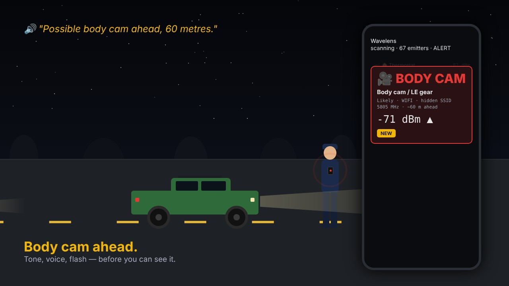</a> 
  Drone overhead, body cam ahead, a phone that keeps reappearing behind you — tone, voice and flash before you can see any of it. <a href="https://youtu.be/8R2Y43eKz08">Watch the 30-second spot on YouTube</a> (or the <a href="https://github.com/pmcbrien/wavelens/raw/main/docs/promo/wavelens-promo.mp4">mp4</a>).

  
   
  Two short walk-throughs filed with Google Play: <a href="https://youtu.be/09LMsqHtMFQ">how location is used</a> · <a href="https://youtu.be/wceR7j8M568">how Bluetooth and Wi-Fi scanning run in the background</a>.

  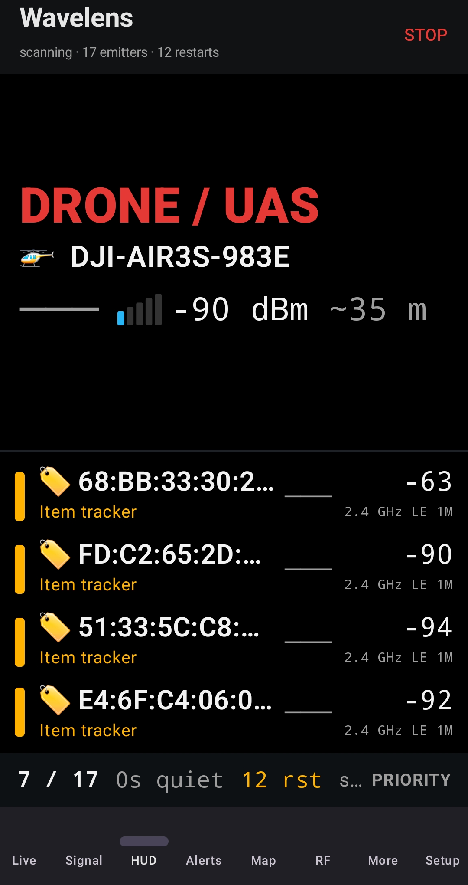
  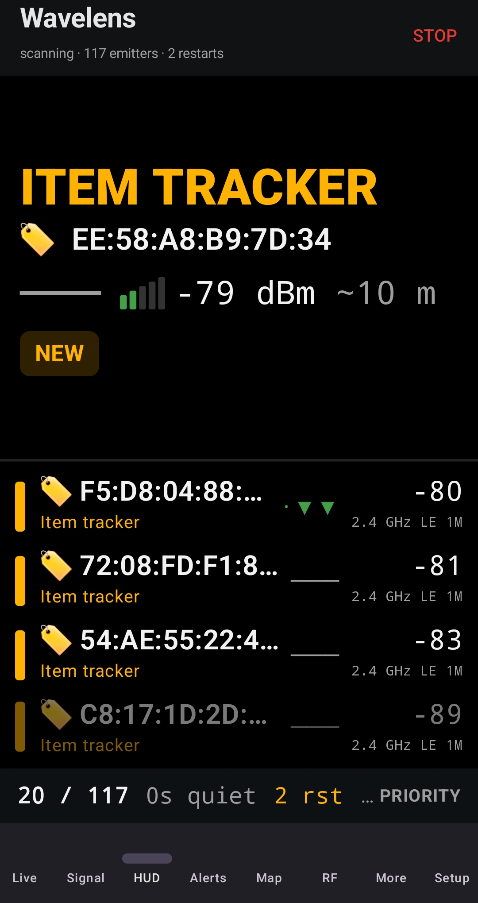
  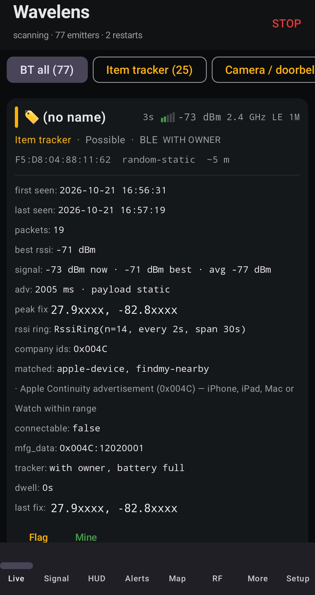

*Screenshots are from real drives; GPS coordinates are masked. A few are from earlier builds that still carried the working title "SIGINT Scope".*

---

## Beta testers wanted

Wavelens is heading to the Google Play Store. Before it can go live, Google requires a closed test with real users — and testers get the Play Store version **free, permanently**, including every update after launch.

To join:

1. Email **[wavelensapp@gmail.com](mailto:wavelensapp@gmail.com?subject=Wavelens%20beta%20tester)** with the **Google account address** you use on your Android phone (the one signed into the Play Store). Testers are added by Google account, so a Gmail or Google Workspace address is required.
2. You'll get an invite link back. Accept it, install from the Play Store, and use the app normally for a couple of weeks — driving is where it earns its keep.
3. Send bugs, false alerts and "what was that device?" captures to the same address or open an issue here. The CSV export on the Setup screen has everything needed to write a new signature rule.

No fixed commitment beyond actually using it. Twelve people is the minimum Google needs; more is better.

### How to contribute to the beta

You don't need to be technical. The most useful thing is a few real drives and honest notes. In rough order of value:

1. **Drive with it.** Phone on the dash or in a pocket, screen off, SCAN running. Commutes, errands, a highway stretch, a parking garage. Note anything that alerted you and whether it was right.
2. **Mark your own kit "Mine"** (earbuds, watch, car, home Wi-Fi) in the first five minutes so your own gear stops showing up — then tell us if anything of yours still alerts.
3. **Report false alarms** — a "tracker" that was your passenger's AirPods, a "body cam" that was a bus. Open the device card, tap **Flag**, screenshot it, and send the screenshot. That card is the whole story: what it matched and why.
4. **Report misses** — something you *know* was there (your own AirTag in the glovebox, a drone you could see, a plate-reader pole you drive past daily) that the app didn't call. Say what it was and roughly where in the list it appeared, if at all.
5. **Send a diagnostics report** when something feels off: **More → Share diagnostics**. It's a scrubbed text report (app and Android version, scanner health and restart count, your alert settings, device counts by category — no coordinates, no identifiers) that you can read before you send it. Restart counts above a handful per hour are exactly the kind of thing we want to see.
6. **Export a CSV** (Setup → Export) for anything you'd like a new signature rule for — a camera, a sensor, a brand of tracker. The CSV has the vendor prefix, services and advertisement bytes needed to write one.
7. **Tell us what confused you.** A screen you didn't understand, a setting you couldn't find, a word that didn't mean what you expected. First impressions are only available once.

Include your phone model and Android version in the first message; after that, just the screenshot or report. Send everything to **wavelensapp@gmail.com** or [open an issue](https://github.com/pmcbrien/wavelens/issues). Please don't post other people's device names or addresses in public issues — email those.

For the Play test to count, install from the Play Store after accepting the invite, and keep it installed for the two weeks.

---

## Install

Wavelens is distributed only through Google Play. While it is in closed testing:

1. Email **[wavelensapp@gmail.com](mailto:wavelensapp@gmail.com?subject=Wavelens%20beta%20tester)** with the Google account on your phone. You'll get an opt-in link and a code that makes the app free.
2. Open the link on your phone, tap **Become a tester**, redeem the code, and install from the Play Store.
3. Open Wavelens, tap **SCAN**, read the short disclosure, and grant:
   - **Nearby devices / Bluetooth** — to hear BLE advertisements and classic discovery.
   - **Location (precise)** — Android requires it for any Bluetooth/Wi‑Fi scan results; Wavelens also uses it to geotag detections and to tell when something is moving with you.
   - **Notifications** — the persistent "scanning" notification and alerts.

The first scan takes a few seconds to populate. In a city you'll see hundreds of emitters within a minute; the Live screen hides the boring ones by default (see *Main screen* in Setup).

Updates arrive through the Play Store like any other app. If you installed an early test build from a download link, uninstall it before installing from Play — Android will not update across signing keys.

---

## What it finds

| Category | Examples | Colour |
|---|---|---|
| ALPR / fixed camera | Flock, Motorola/Vigilant, Genetec, Axis, Avigilon, Verkada | red |
| Acoustic sensor | ShotSpotter‑class gunshot sensors | red |
| Drone / UAS | DJI, Autel, Parrot, Skydio; any aircraft broadcasting Remote ID | red |
| Body cam / LE gear | Axon, Motorola/WatchGuard, Getac, in‑car LTE routers | red |
| Pentest / RF tool | Flipper Zero, HackRF, Ubertooth, Pwnagotchi, O.MG | red |
| Item tracker | AirTag, SmartTag, Tile, Chipolo, Find My / FMDN beacons | amber |
| Traffic / MAC sensor | Bluetooth travel‑time and occupancy sensors | amber |
| Camera / doorbell | Ring, Nest, Arlo, Wyze, Blink, Kuna, Eufy | amber |
| Fleet / telematics | Samsara, Lytx, SmartDrive, Zonar, CalAmp, Trapeze, Luminator, Init, PeopleNet, Trimble, Seon, Verizon Connect — and the Cradlepoint, Sierra Wireless and Peplink routers every fleet uses | blue |
| Vehicle / TPMS | BLE tyre sensors, OBD dongles, car head units | blue |
| Phone / tablet | Apple Continuity, Android, Windows | blue |
| Wearable / audio | watches, earbuds, hearing aids | blue |
| IoT sensor, beacon, AP / network gear | smart home, iBeacon/Eddystone, routers | green |
| Cell site | your serving and neighbour towers (RF tab) | grey |

With a [companion radio](#companion-radios) — an ESP32, a Pi with an SDR, or a carputer feeding the app over Bluetooth — the list grows to what a phone's radios can't reach:

| With a companion | Examples | How sure |
|---|---|---|
| Hotspots on any channel | Body-cam and in-car hotspots on 5 GHz, hidden-SSID setup networks, anything on the channel you park on | Likely — every beacon on a parked channel instead of one sweep in forty; same vendor-prefix rules |
| Sub-GHz devices | TPMS, garage and gate remotes, weather and door sensors, LoRa / 915 MHz telemetry | Likely — decoded by name with rtl_433 on an RTL-SDR, or a CC1101 / SX1276 on the ESP32 |
| 5.8 GHz video links | FPV drones, analog camera links, wireless video senders | Possible — a carrier where video lives (RX5808 or a HackRF sweep); nothing names it |
| Licensed radio, by owner | Sheriff and police dispatch, county DOT, transit, utilities, towing and taxi fleets — by name, call sign and distance to their site | Likely — from the FCC's public license records for your county ([local pack](companion/README.md#local-fcc-license-pack--who-owns-that-carrier)); says whose radios are in range, not that one is watching you |
| Aircraft overhead | Anything transmitting ADS‑B: callsign, altitude, position | Certain, unclassified — dump1090 on an RTL‑SDR; an airliner is not a drone, so it is shown but never alerted |
| Any carrier to 6 GHz | 1.2 GHz links, 900 MHz ISM, 433 and 315 MHz bursts, anything that stands out of the noise | Possible — HackRF sweeps report energy by band: "something is transmitting here", never a name without a licence record behind it |

Everything else is bucketed by manufacturer using the IEEE OUI and Bluetooth SIG company registries, which ship inside the app. Confidence is shown as **Possible / Likely / Confirmed**. *Confirmed* is reserved for devices that describe themselves — Remote ID, Find My / FMDN frames, a specific service — or a model name backed by the matching vendor. A vendor prefix or company ID alone says "this maker's hardware" and tops out at *Likely*, however many registry rules agree, because the same radio sits in a body cam, its dock and a transit bus. Treat Likely as a reason to look, and Confirmed as a reason to act.

  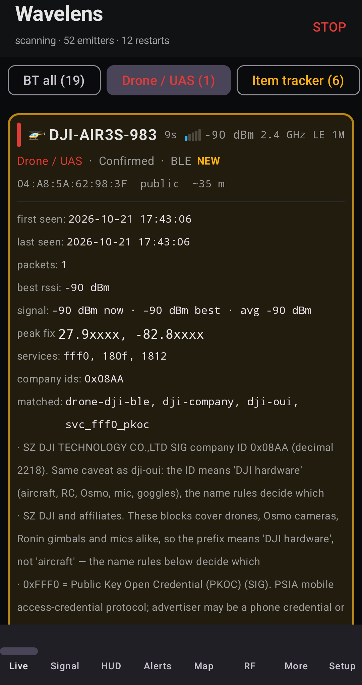
  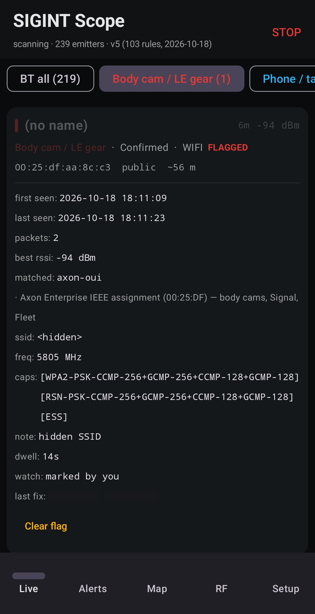
  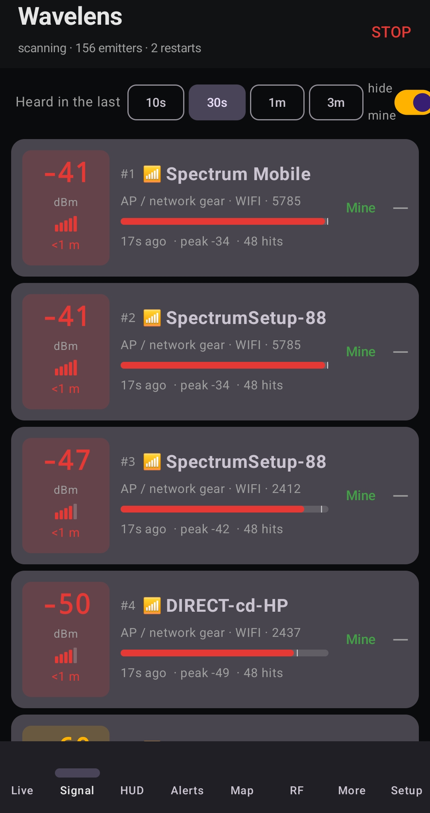

  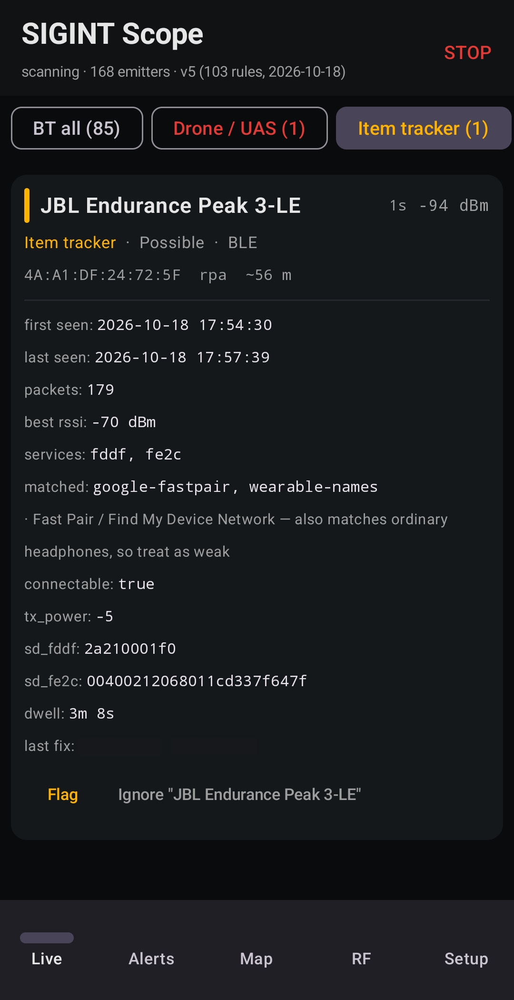
  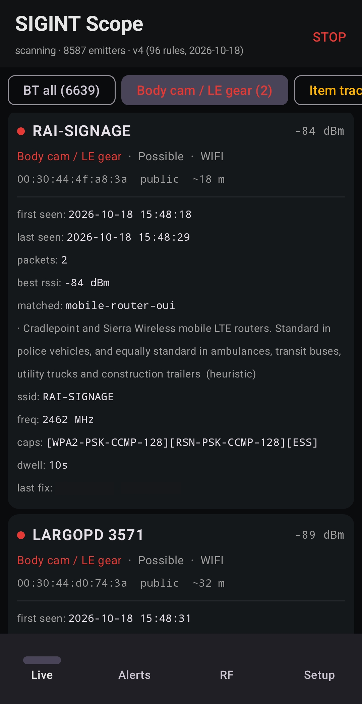

The rule that matched is always shown on the card with a one‑line reason, including when the match is weak ("also matches ordinary headphones, so treat as weak"). The classifier is a best‑effort guess from public signatures — look before you act on it.

---

## The screens

### Live
The main list. Strongest signal first, with a glyph for the device kind (🔔 doorbell, 🛞 TPMS, 🎥 body cam, 🚁 drone, 🏷 tracker, 📷 camera …), the current dBm, the last frequency heard (Wi‑Fi channel, BLE PHY, or cell band), an estimated distance, and badges: **NEW** highlight box, **FLAGGED**, **FOLLOWING**, **RIDING / PACING**, **MINE**, **WITH OWNER / SEPARATED** for trackers. Filter chips across the top narrow by category. Tap a card for details; alert‑worthy cards open expanded automatically.

A card's details include first/last seen, packet count, signal now/best/average, advertising interval and whether the payload is static, the services and company IDs it advertises, the matched rules with their explanations, the raw manufacturer data, dwell time, and the peak‑signal fix. Buttons: **Flag**, **Mine**, **Ignore "<name>"**.

### Signal
What is close to you *right now*. Every device heard in the last 10 s / 30 s / 1 min / 3 min, strongest first, ranked by current signal with a small penalty per second since it was last heard. Each row has a large dBm block colour‑coded red (≥ −50, touching the phone) / amber (≥ −65) / green (≥ −80) / blue (weaker), a five‑bar meter, a rough distance hint, a level bar with a white peak‑hold tick, and the trend arrow. Rows for flagged, following, riding or high‑threat devices are tinted red. Use it to walk a car or a room: the top row is the thing you are closest to.

### HUD
A driving view in three bands. The **verdict**: one phrase for the whole table, coloured — FOLLOWING, FLAGGED, TRACKER WITH YOU, RIDING WITH YOU, PLATE READER, POSSIBLE CAMERA (a vendor‑only hit on hold for its second pass is amber, never red), WATCHING, CLEAR — with a one‑line reason. The **device** behind it: name, a wide signal meter, distance, closing / steady / pulling away, chips, and two large buttons, MINE (with undo) and FLAG, because gestures are the wrong interface at 45 mph. Then up to three runners‑up and a **status strip**: scanner dot, road mode, a battery warning if the app is optimised, counts, and the sort order (priority / signal) as a tappable chip. Everything that names a device is tappable — the verdict band ("why ›"), the top device, each runner‑up — and opens the same detail sheet the Signal and Alerts tabs use, so "why is it saying that?" is one tap, not a trip to another tab.

### Device details
One sheet for every device, wherever you open it from (HUD, Live card, Signal, Alerts). Live strength at the top, then status chips (FOLLOWING · 4 spots, RIDING WITH YOU, SEPARATED FROM OWNER, FLAGGED, 2ND PASS · waiting, RECURRING, NEW, fixed emitter, MINE …), then the actions in one row — Flag, Mine / Not mine, Ignore, What is this?, Why "Following you"?, Open in maps, Copy, Share — and only then the detail, grouped into sections you can fold: **Why this verdict** (category, what the confidence level means, every matched rule with its note and whether it's a heuristic, companion hints, second‑pass and tracker‑gate state), **Signal & timing** (now / best / average, distance with the tx power it assumed, trend, frequency, advertising cadence, packet rate, first and last seen, how long it's been heard), **Movement** (following and co‑move evidence, dwell, route verdict), **History** (encounters over days and places, peak localised from passes, recurring / fixed / known / watchlist), **Position** (where *you* were at the strongest reading and the last fix, with distance from here), **Tracker**, **Remote ID**, **Identity** (address and what its type implies about rotation, previous address if it rotated, vendor, company IDs, services, companion route) and **Raw data**, folded by default.

### Alerts
Built for "what was that?". One row per alert, newest first, repeats of the same device collapsed with a count; filter chips for cameras & LE gear, trackers, drones, riding & following, recurring; a dot on anything that fired since you last looked, and a count on the tab itself. Each row says what matched, how strong it was then, whether the device is **still here** (with its signal now), and how far from here you were when it fired. Tap one and the device opens — live if it is still in range, otherwise the snapshot from the moment it alerted — with when and where, the tail replay if there is one, Flag / Mine / Ignore, "What is this?", open the spot in your maps app, copy or share the details. A **Recurring devices** block sits at the top and the raw scanner event log folds away underneath. The alert log is also written to disk as CSV as it happens, so a crash or battery death loses nothing and last night's alerts are still there after a restart. Export from Setup.

### Map
Trails of moving devices by name over a chosen time window, and **convoys** — groups of devices that keep turning up together.

### RF
Serving and neighbour cell sites with tech (LTE / 5G NR / WCDMA / GSM), PCI/CID, channel number and the downlink frequency it maps to, and signal strength. A 2G fallback on the serving cell is called out.

### More
Feature screens that don't need a tab of their own:

- **Routes** — learns the roads you drive regularly and the fixed emitters along them, then alerts on a *new* camera, sensor or AP on a regular route. See [Routes](#routes-new-on-your-route).
- **Tails** — the unified "is this device tailing me?" verdict with a map replay of your path against the device's hits and gaps. See [Tails](#tails).
- **Trips** — a report for every drive: duration, distance, cameras passed, trackers heard, anything that rode or followed, alerts raised; export as PDF or KML. See [Trips](#trips).
- **What is this?** — a plain‑English card for every category and every verdict: what the hardware is, who deploys it, what it can and can't see, how Wavelens recognises it, and what to do. The same cards open from the **What is this?** button on any expanded device card.
- **Share diagnostics** — builds a scrubbed report (app/Android version, scanner health and restarts, your alert settings, device counts by category, classified hardware by vendor prefix, optionally this session's alerts by category) and hands it to the share sheet. The app has no network permission, so nothing goes anywhere until you pick where.
- **Signature packs** — see the active and bundled pack versions, and import an updated pack offline with a diff of what changed. See [Signature pack](#signature-pack).

### Setup
Behind the gear in the top bar (Back returns you to where you were). Ten collapsible sections; every setting, in the order it appears. Defaults in **bold**.

  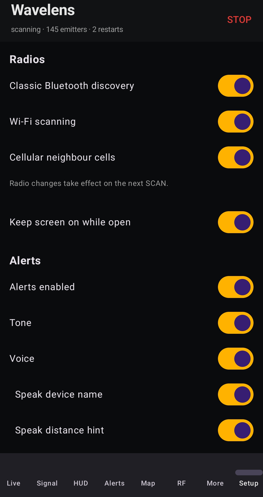
  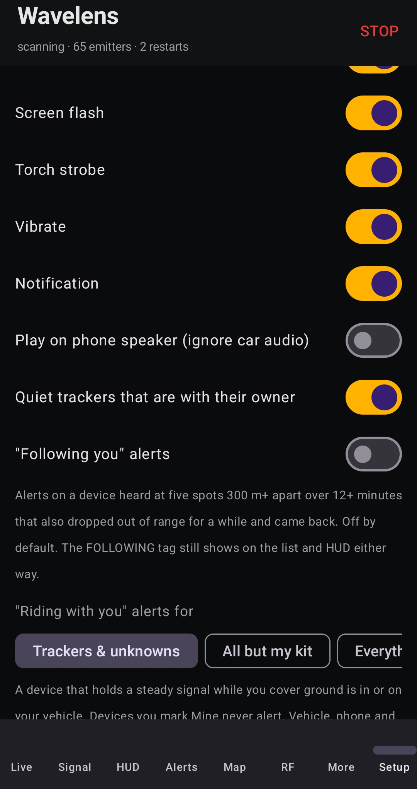
  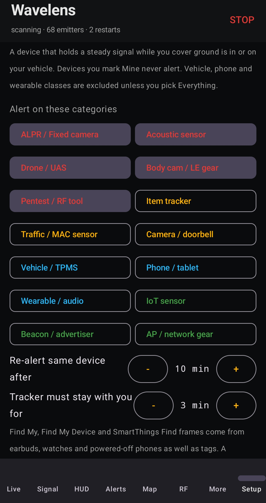

#### Radios
| Setting | Default | What it does |
|---|---|---|
| Classic Bluetooth discovery | **off** | Runs a BR/EDR inquiry every 90 s alongside BLE. Finds older hands‑free kits and OBD dongles that are discoverable (pairing mode) and don't advertise on BLE. Off by default because each inquiry takes the radio away from LE scanning for about 12 s, and on some phones LE did not come back afterwards; when on, the app now stops and restarts the LE scan around each inquiry itself. |
| Wi‑Fi scanning | **on** | Reads nearby access points and client probes. This is how ALPR units, body cams and dash cams with a hotspot are found. Android throttles scans to four per two minutes unless *Developer options → Wi‑Fi scan throttling* is off. |
| Cellular neighbour cells | **on** | Logs the serving and neighbour cell sites for the RF tab and the cell CSV. Needs location permission. |

Radio changes take effect on the next **SCAN**.

#### Display
| Setting | Default | What it does |
|---|---|---|
| Keep screen on while open | **on** | Holds the screen on while the app is in front (a phone mount). Scanning continues with the screen off either way. |

#### Alerts
| Setting | Default | What it does |
|---|---|---|
| Alerts enabled | **on** | Master switch. Off, the app still classifies and logs everything; it just stays silent. |
| Tone | **on** | Distinct tones per class: tracker, camera/ALPR, body cam (a short siren). |
| Voice | **on** | Text‑to‑speech, e.g. "Possible body cam, close". |
| └ Speak device name | **on** | Appends the advertised name or vendor to the voice line. |
| └ Speak distance hint | **on** | Appends "close / nearby / far" from the signal strength. |
| Screen flash | **on** | Three red flashes over whatever is on screen. |
| Torch strobe | **on** | Pulses the camera LED — visible with the phone face‑down in a cup holder. |
| Vibrate | **on** | One 180 ms buzz per new alert. |
| Notification | **on** | A heads‑up notification with the alert text, so it shows over navigation apps. |
| Play on phone speaker (ignore car audio) | off | Routes tones and speech to the handset speaker even when the car's Bluetooth audio is connected, so an alert isn't swallowed by a paused podcast. |
| Quiet trackers that are with their owner | **on** | An AirTag/Find My device advertising "owner nearby" is someone's keys in the next lane; don't alert on it. Separated trackers are unaffected. |
| "Following you" alerts | off | Alerts when a device is heard at 5 spots ≥ 300 m apart over ≥ 12 minutes **and** dropped out of range for ≥ 3 minutes in between. Off by default because cars sharing the road pass the first test; the FOLLOWING tag still shows on the list and HUD either way. |
| "Riding with you" alerts for | **Trackers & unknowns** | Which categories a *riding with you* verdict may alert on: trackers/unknowns/beacons/IoT only; everything except vehicle, phone and wearable classes; or everything. Devices you mark **Mine** never alert. |
| Alert on these categories | **ALPR, Acoustic, Body cam / LE gear, Drone, Pentest tool** | The categories that raise an alert when first heard. Item trackers are off here by default: a tracker that rides with you still alerts through the riding path, and flagged or following devices alert regardless. |
| Re‑alert same device after | **10 min** | How long a device stays quiet after it alerts. Registry‑identified hardware (body cams, ALPR, acoustic) is de‑duplicated by vendor prefix, so a camera's Wi‑Fi and BLE radios alert once, not twice. |
| Tracker must stay with you for | **3 min** | Find My, Find My Device and SmartThings Find frames are sent by earbuds, watches and powered‑off phones as well as tags, and a tag in the parked car beside you isn't news. A separated tracker alerts only after it has been with you this long — or at once if it rides or follows. 0 alerts immediately. |

#### Encounter history
| Setting | Default | What it does |
|---|---|---|
| Alert on recurring devices | **on** | Says "Recurring device" once per session for a device seen at home *and* elsewhere, or in three places, on two or more days. **Ack** silences it; **Mine** fingerprints it as yours. |
| Quiet known fixed emitters | **on** | A camera or AP you've passed in the same spot in three or more sessions is scenery: it's logged as *known fixed* rather than alerted. Does not apply to flagged, following, riding or separated devices. |
| Battery (Scanner health card) | **check it** | Android slows Bluetooth delivery for battery‑optimised apps while the screen is off, foreground service or not — the scan stalls every minute or so and takes 15–30 s to recover after each restart. The card at the top of Scanner health shows whether Wavelens is *Unrestricted* and opens the app's settings page to change it (Samsung: also add it to *Never sleeping apps*). |
| Confirm vendor-only hardware on a second pass | **on** | A plate‑reader, body‑cam, camera or sensor hit that rests on a vendor prefix alone (*Possible*) is a pole or a bus, an ambulance, a fleet truck with the same radio — one packet cannot tell. Heard once at speed it is listed and tagged with one soft tick instead of the alert tone; it alerts in full when heard at the same spot on another day (then shown as *fixed*, Likely), or, parked, after two minutes in range. Named and registered signatures alert on the first packet regardless. |
| Forget one‑off devices after | **30 days** (7–90) | Retention for devices heard in a single session. Recurring devices and fixed emitters are kept. |

Also here: the count of known fixed emitters at your current location, recurring devices pending review, **Export history CSV**, **Clear history**.

#### Scanner health
| Setting | Default | What it does |
|---|---|---|
| Auto‑restart on stall | **on** | Android can stop delivering BLE results without reporting an error. The watchdog watches the Bluetooth clock alone and cycles the radios in‑process when nothing arrives. If a restart brings nothing back it waits twice as long before the next (up to 8×), and it holds off entirely for a minute after Android refuses a scan. |
| Restart after silence of | **45 s** (20–300) | The silence that counts as a stall. |
| Restart scan now | — | Manual cycle. |

If the status line says *Location Services is off*, turn it on: Android withholds all Bluetooth scan results without it, and no restart can help.

#### Main screen
| Setting | Default | What it does |
|---|---|---|
| What holds the list | **Trackers +** | Threat threshold for the Live list: Everything / Phones + / Trackers + / LE only. Anything at or above it stays for the live window; everything else shows while new or still transmitting, then drops off. Flagged and following devices always stay. |
| Highlight new devices for | **20 s** (0–120) | Amber border on a device the first time it's heard. |
| Auto‑expand details on interesting hits | **on** | Alert‑worthy cards open with their details showing. |
| Keep quiet devices for | **30 s** (5–300) | How long a below‑threshold device lingers after its last packet. |
| Live window (above threshold) | **5 min** (0–60) | How long an above‑threshold device stays after its last packet. 0 = forever. |
| Ignore weaker than | **−100 dBm** (−110…−40) | Floor for both the list and alerts. Raise it to −85 in a dense car park to see only what's near. |

#### Sessions
| Setting | Default | What it does |
|---|---|---|
| Record drives to disk | off | Writes every observation and GPS fix to a gzip NDJSON file while scanning (≈ 5–10 MB per hour in a city). |
| Keep newest sessions | **20** (1–200) | Oldest recordings are deleted when a new one starts. |
| Marker | — | Drops a timestamped note into the recording ("passed the white van"). |

Each recording can be **exported**, **replayed at 1× or 10×** (live packets are muted and the recording is fed through the classifier — test a new signature pack against last week's drive) or **deleted**.

#### Export
**CSV** of all emitters · **KML** for Google Earth (each device at its averaged peak‑signal position; drones at altitude with the operator as a second placemark) · **Cells** CSV · **Unknowns** report (unclassified devices with everything needed to write a rule) · **Alert log** CSV (written to disk as alerts happen, so a crash loses nothing) · **Clear alert log**.

#### Watchlist rules
Every device you've **Flagged** or marked **Mine**, with the fingerprint traits it matches on. Remove one, or **Remove all rules and clear flags**. The watchlist can be exported as JSON and imported on another phone.

#### Ignored names
Name fragments hidden from the list entirely, added with the **Ignore** button on a device card. Matched as case‑insensitive substrings, so "Ring Setup" hides the whole family.

#### Signatures
**Import pack** (JSON) replaces the bundled signature pack; **Reset** goes back to it. The richer flow with a diff of what changed is under **More → Signature packs**.

#### Debug
**Clear all tracks** empties the live table. **Test alert** fires a synthetic body‑cam alert so you can check tone, voice, flash, torch and speaker routing without waiting for a real one.

#### More → Routes, Tails, Trips
| Setting | Default | What it does |
|---|---|---|
| Routes → New‑on‑route alerts | **on** | Alert when a fixed‑type device with a public address first appears in a grid cell you've driven in ≥ 4 sessions on ≥ 3 days. |
| Routes → Forget routes | — | Wipes the learned route cells and baseline. |
| Tails → Tail alerts | **on** | Alert once per session when a device reaches the TAIL verdict. |
| Trips → Auto‑record raw sessions | off | Starts the Sessions recorder with every scan so the full packet log exists for each trip. |
| Trips → Keep | **50** (1–500) | Trip reports to keep; oldest are deleted. |

---

## Features in depth

### Alerts while you drive
Distinct tones for trackers, cameras/ALPR, and body cams, plus spoken alerts ("Possible body cam, RAI‑SIGNAGE, close"), screen flash, torch strobe, vibration and a heads‑up notification — each one a toggle. Alerts can be forced to the phone speaker so they aren't swallowed by a car's Bluetooth audio. Pick which categories alert and how long before the same device re‑alerts. The scanner keeps running with the screen off; the screen stays on while the app is in front.

### Flag once, recognise forever
Phones and trackers rotate their Bluetooth address every few minutes, so a MAC is useless for "is that the same device?". **Flag** builds a weighted fingerprint from what *doesn't* change — vendor prefix, service UUIDs, manufacturer‑data prefix, service‑data prefix, name, Wi‑Fi cipher suite and channel, advertising‑interval class, static payload — and matches on that. A device scoring ≥ 4 with at least one identity‑bearing trait is shown **FLAGGED** again, address or no address. Every body‑cam, ALPR and acoustic alert is auto‑fingerprinted, so the second time you pass the same camera it says **Known** rather than *Possible*.

### Riding with you
A device that holds a steady signal while you cover ground is in or on your vehicle. Every track with enough packets keeps a signal‑strength ring; every 10 seconds it is scored against your own GPS motion. Steady (IQR ≤ 10 dB) over 400 / 1 500 / 5 000 m becomes **POSSIBLE / LIKELY / CONFIRMED**, with an **in vehicle** tier when it's strong and very flat; stop‑and‑go traffic or a 90° turn with the signal unchanged promotes it a level. Scanner stalls and restarts are treated as gaps, not as "device gone". Traffic jams and parking don't count — the window needs real path length and speed. Alerts fire at LIKELY. Tap **Mine** on your own earbuds, watch or car and they're fingerprinted and never alert. Scope the alerts to trackers only, everything but vehicle/phone/wearable, or everything.

### Following
Separate from riding: a device heard at five or more positions ≥ 300 m apart over at least 12 minutes **that also dropped out of range for three minutes or more and came back** is **FOLLOWING**. The drop‑out is what separates a tail from the car in the next lane, which never leaves range. A separated Find My / FMDN tracker needs only two positions and two minutes. The tag always shows; alerting on it is a toggle, off by default.

### Routes (new on your route)
More → Routes. The app grids the world into ~250 m cells and counts the sessions and days you've been in each one. A cell visited in four or more sessions on three or more days is part of a regular route. Every fixed‑type device with a public address (ALPR, acoustic, traffic sensor, camera, AP, body‑cam vendor hardware) is filed under the cell where it was strongest. When one appears in a regular cell — and in none of the eight neighbouring cells — that it has never been filed in before, you get **New on your route** once per session. A fresh ALPR pole on your commute is the point. Cards show *known on this route* or *new on a regular route (cell visited N times)*.

### Tails
More → Tails. One verdict that combines the following heuristic and the riding‑with‑you score with the thing that matters most: re‑acquisition. For every device the app keeps the segments where it was in range and the gaps between them. **TAIL** = following, or riding with ≥ 2 re‑acquisitions. **WATCH** = three spots, one re‑acquisition and six minutes, or riding with one re‑acquisition. The card carries a narrative ("Appeared behind you 3 times across 22 min; dropped out twice, longest 4 min; 6 spots over 5.1 km") and opens a replay: your own path in grey, the device's hits as dots coloured by signal, gaps dashed, and a scrubber to step through time. **Share evidence** writes the narrative plus a CSV of every fix.

### Trips
More → Trips. Every scan session becomes a trip: duration, distance, top speed, cameras and sensors passed (with names and where), body‑cam encounters, trackers heard and their verdicts, drones, every alert, and the five most notable devices. The in‑progress trip is shown while you drive. **Export PDF** for a readable report, **Export KML** for the path and notable devices in Google Earth.

### Encounter history and baseline
An on‑device SQLite database records where (0.0025° cells) and when every device is heard, learns your home cell, and summarises each device as *places / days / sessions*. A device heard at home **and** across town (or in three places) on two or more days announces **Recurring device** once per session. Fixed emitters you've passed in the same spot three or more sessions go quiet, so the alerts stay meaningful. Retention 7–90 days, CSV export, clear.

### Peak signal across passes
The KML export places each device at the averaged peak‑signal position across every pass, which localises a fixed camera far better than any single drive‑by.

### Remote ID (drones)
ASTM F3411 / Open Drone ID on BLE is decoded: UAS ID, aircraft type, position, altitude, speed, heading, **operator location**, operator ID and self‑ID text. The voice alert gives the operator's distance ("Drone, operator 340 metres away"). KML places the aircraft at its reported altitude with the operator as a second placemark.

### Session record and replay
Setup → Sessions. Records every observation and GPS fix to a gzip NDJSON file while scanning (≈5–10 MB per hour in a city); replay feeds a recording back through the classifier with live packets muted, so a new signature pack can be tested against last week's drive. Export the raw file for analysis on a laptop.

### Scanner watchdog
Android's BLE scanner sometimes silently stops delivering. Wavelens watches the Bluetooth clock alone (Wi‑Fi and cells keep ticking through a BLE stall), cycles the radios in‑process when it goes quiet, and shows the restart count in the status line. It respects Android's limit of five scan starts per 30 seconds, backs off after a restart that brings nothing back, logs the reason when Android refuses a scan, and tells you when Location Services being off is the real cause.

### Exports
CSV of all emitters, CSV of cell sites, KML for Google Earth, the alert log, the history database as CSV, session recordings, and the watchlist as JSON (import on another phone).

---

## Signature pack

The signature pack that ships inside the app: rules are AND‑matched on OUI prefixes, service UUIDs (with wildcards), manufacturer‑data prefixes, service‑data prefixes, names, SSIDs, Wi‑Fi capabilities and channel. Each rule carries a category, confidence, weight and a short explanation that is shown on the card. The pack is versioned and the version shows in the status line.

A pack can also be dropped on the phone as an override and reloaded from Setup without reinstalling the app. **More → Signature packs** shows the active and bundled pack versions, imports a pack with a diff (added / removed / changed rules, "12 new ALPR vendors"), and refuses an older pack unless you confirm the downgrade. There is no rule sharing or crowd-sourcing of any kind; pack updates ship with the app. The rule schema is documented in [docs/SIGNATURES.md](docs/SIGNATURES.md). Found something the pack doesn't know? Open an issue with the capture row (the CSV export has everything needed) and what the device turned out to be.

---

## Companion radios

A phone can't choose which Wi‑Fi channel it listens on, can't hear 433/915 MHz or 5.8 GHz at all, and has an antenna the size of a paperclip. A companion is a second radio with a real antenna — an ESP32, a Raspberry Pi with an RTL‑SDR or HackRF, a carputer — that does the listening and hands every hit to Wavelens over Bluetooth. The app treats it exactly like its own packets (same signatures, alerts, history, map, tails and Rule hits) and can tell it which band or channels to park on. Bluetooth only; the app still has no network permission and nothing leaves the phone.

Everything to build one is in [`companion/`](companion/): the one‑page [line protocol](companion/README.md#line-protocol), the [ESP32 firmware](companion/esp32/wavelens_companion/) (Wi‑Fi beacon sniffer with channel park/hop, BLE relay, optional RX5808 5.8 GHz and CC1101/SX1276 sub‑GHz modules), and the [Pi / carputer bridge](companion/pi/wavelens_bridge.py) with feeds for `rtl_433`, `hackrf_sweep`, `rtl_power`, `dump1090` ADS‑B and Kismet. Pair under **More → Companion radio**; the first one heard is adopted automatically.

  <a href="companion/diagrams/overview.svg">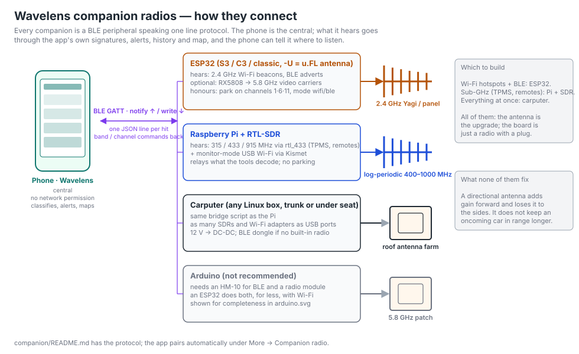</a>

  <a href="companion/diagrams/esp32-directional.svg">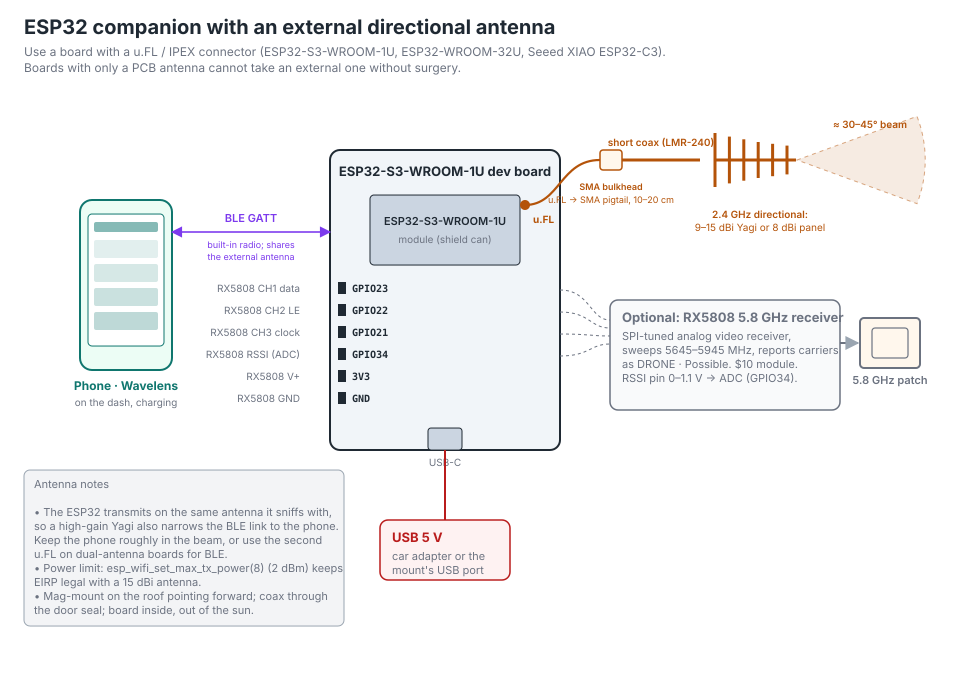</a>
  <a href="companion/diagrams/pi-sdr-directional.svg">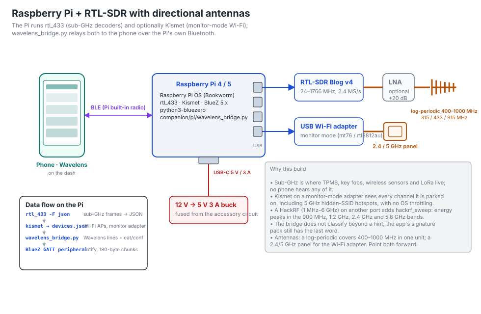</a>

  <a href="companion/diagrams/carputer.svg">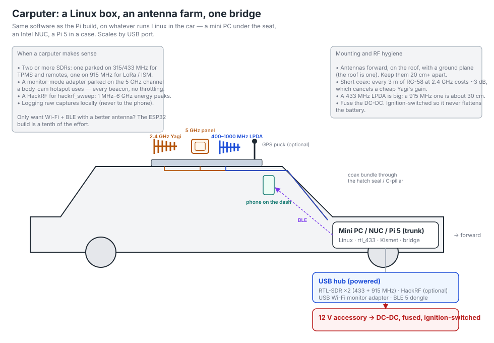</a>
  <a href="companion/diagrams/vehicle-mount.svg">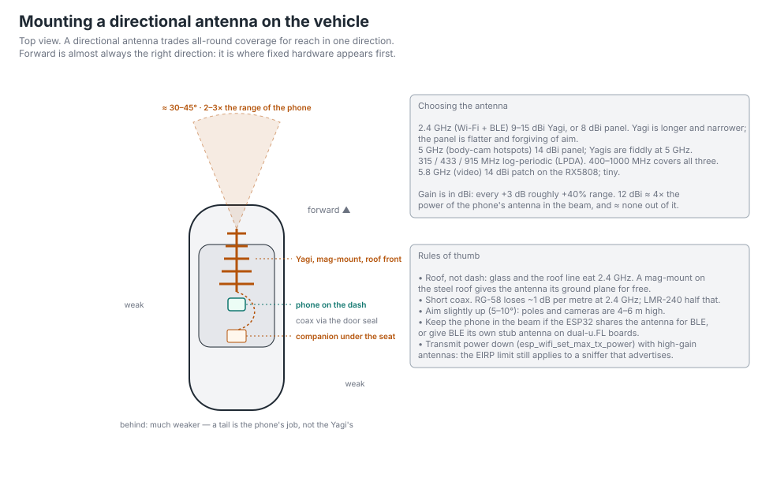</a>

| Build | Hears | Parks on a channel? |
|---|---|---|
| ESP32 (‑U board with u.FL) | 2.4 GHz Wi‑Fi hotspots and BLE adverts · optional 5.8 GHz video carriers · optional 433/315 MHz decoders | Yes |
| Raspberry Pi + RTL‑SDR | rtl_433's sub‑GHz decoders (TPMS, fobs, sensors) · band sweeps below 1.7 GHz · ADS‑B · monitor‑mode Wi‑Fi | No |
| Pi or carputer + HackRF | Energy sweeps 1 MHz–6 GHz: 5.8 GHz video, 1.2 GHz links, 900 MHz LoRa, 433/315 MHz bursts | No |
| Any SDR build + local FCC pack | Licensed carriers named: which agency or business holds the frequency, and how far its site is | — |
| Arduino | Only with a BLE module and a radio module — [build the ESP32 instead](companion/diagrams/arduino.svg) | — |

**Range and warning time, simulated.** A link-budget model ([`companion/tools/range_sim.py`](companion/tools/range_sim.py), every assumption in the file): median ranges with line of sight in the beam, reliable range about half. A BLE beacon on a pole: ~60 m for the phone in the car, ~400 m for an ESP32 with a 12 dBi Yagi on the roof &mdash; 1 s versus 12 s of warning at 70 mph. A Wi‑Fi hotspot: ~230 m versus ~1.9 km. TPMS ~340 m and LoRa nodes ~1.3 km on an RTL‑SDR; 5.8 GHz video 1–5 km; licensed radios to the horizon, which is why those are "in range", not "near you". Oncoming traffic at highway speed stays out of reach for anything that has to hear the device first. Full table in [companion/README.md](companion/README.md#range-and-warning-time-simulated).

  <a href="companion/diagrams/range-sim.svg">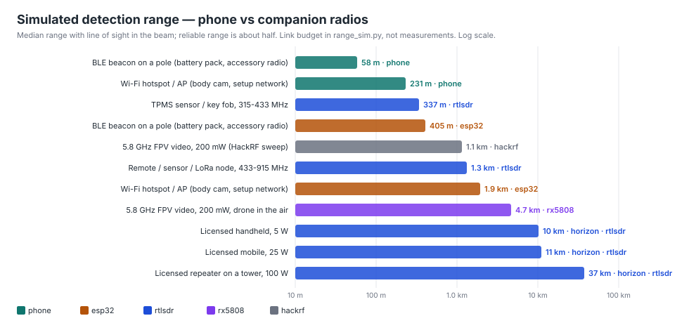</a>

**Status:** the app side ships in the current build. The firmware and bridge are written against the documented APIs and have not yet been run on hardware; expect to fix a signature or two on first build, and please send a pull request when you do. A directional antenna makes the app hear more and sooner; it does not keep an oncoming car at highway speed in range any longer — see [Does it work?](https://wavelensapp.us/results.html).

---

## Privacy

- No network permission. Nothing leaves the phone except files you export yourself — including **More → Share diagnostics**, a scrubbed report (no coordinates, cell IDs, rotating addresses or personal device names) that you read in full and then hand to the share sheet.
- Detections, alerts, history, fingerprints and recordings live in the app's private storage and are excluded from Android backup and device transfer.
- Full policy: [docs/index.html](docs/index.html) (also at [pmcbrien.github.io/wavelens](https://pmcbrien.github.io/wavelens/)).

---

---

## Disclaimer

Wavelens only listens to transmissions that devices make in the clear, which is lawful in most jurisdictions, but check yours. Classification is a best‑effort guess from public signature data and can be wrong in both directions. It is a situational‑awareness tool; what you do with that awareness is on you.

© Patrick McBrien. Wavelens is free to download and use from this page; redistribution of the app or its signature pack is not permitted without permission.
